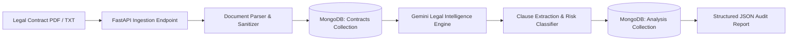

# Lexiscan — Automated Legal Contract Parsing & Intelligence Engine

[](https://fastapi.tiangolo.com)
[](https://www.python.org/)
[](https://ai.google.dev/)
[](https://www.mongodb.com/)
[](https://opensource.org/licenses/MIT)

**Lexiscan** is an asynchronous legal contract auditing and intelligence API built with **FastAPI**, **Google Gemini GenAI**, and **MongoDB**. It automates legal due diligence by ingesting raw legal contracts (PDF/TXT), parsing semantic clauses, identifying non-standard provisions, categorizing risk severity, and generating actionable remediation recommendations.

---

## ⚡ Key Capabilities

- **Resilient Multi-Format Ingestion**: Validates, sanitizes, and extracts text content and metadata (page counts, word counts) from PDF and TXT documents.
- **Automated Clause Segmentation**: Identifies and isolates key clauses (Indemnity, Non-Compete, Termination, IP Rights, Confidentiality) and compares them against standard legal conventions.
- **Multi-Tier Risk Assessment**: Classifies contract risks into 4 distinct severity tiers (`Low`, `Medium`, `High`, `Critical`) with targeted mitigation advice.
- **Executive Summaries**: Produces plain-English executive summaries tailored for legal counsel and business stakeholders.
- **Document & Audit Persistence**: Stores processed documents and immutable audit trails in MongoDB with indexed queries.

---

## 🏗️ Architecture & Pipeline



---

## 🛠️ Tech Stack

| Layer | Technology | Purpose |
| :--- | :--- | :--- |
| **Backend Framework** | [FastAPI](https://fastapi.tiangolo.com/) | High-performance asynchronous REST API routing and OpenAPI generation |
| **LLM & Reasoning** | [Google Gemini](https://ai.google.dev/) | Deep legal reasoning, clause classification, and risk evaluation |
| **Document Processing** | [PyPDF2](https://pypdf2.readthedocs.io/) | Stream parsing and textual extraction from legal PDFs |
| **Data Validation** | [Pydantic v2](https://docs.pydantic.dev/) | Strongly-typed schemas, request validation, and JSON serialization |
| **Database** | [MongoDB](https://www.mongodb.com/) | Schema-flexible document storage for parsed contracts and analytical audits |
| **Infrastructure** | [Docker Compose](https://docs.docker.com/compose/) | Containerized local MongoDB deployment |

---

## 🚀 Getting Started

### 1. Prerequisites
- **Python 3.10+**
- **Docker & Docker Compose** (for local MongoDB) or an active MongoDB Atlas instance
- **Google Gemini API Key** ([Get an API Key](https://aistudio.google.com/))

### 2. Clone the Repository
```bash
git clone https://github.com/awasthypranshu/Lexiscan-Highlighting-automated-legal-parsing-and-intelligence..git
cd Lexiscan-Highlighting-automated-legal-parsing-and-intelligence.
```

### 3. Environment Setup
Create a virtual environment and install dependencies:
```bash
python -m venv venv

# Windows (PowerShell):
.\venv\Scripts\Activate.ps1

# Linux / macOS:
source venv/bin/activate

pip install -r requirements.txt
```

### 4. Configure Environment Variables
Copy `.env.example` to `.env`:
```bash
cp .env.example .env
```
Update `.env` with your credentials:
```env
MONGODB_URI=mongodb://localhost:27017
GOOGLE_API_KEY=your_gemini_api_key_here
```

### 5. Launch MongoDB
Run MongoDB in a Docker container:
```bash
docker compose up -d
```

### 6. Run the Application
Start the FastAPI development server:
```bash
uvicorn app.main:app --reload
```
The API will be available at `http://127.0.0.1:8000`.

---

## 📖 API Documentation & Endpoints

Interactive Swagger documentation is available at: **`http://127.0.0.1:8000/docs`**

### Core Endpoints

#### 1. System Health Check
```http
GET /
```
**Response:**
```json
{
  "app": "Lexiscan - Automated Legal Parsing & Intelligence API",
  "version": "1.0.0",
  "status": "operational",
  "docs": "/docs"
}
```

#### 2. Upload Contract
```http
POST /contracts/upload
Content-Type: multipart/form-data
```
Uploads a `.pdf` or `.txt` contract file (max 10MB) for ingestion and extraction.

**Sample Response:**
```json
{
  "message": "Contract uploaded successfully",
  "contract_id": "672659e13a4bc602b9f8d91a",
  "contract": {
    "file_name": "7a30cf7f41d94b05a74e5088920194bc.pdf",
    "original_name": "Vendor_Master_Agreement_2026.pdf",
    "page_count": 8,
    "word_count": 3420,
    "status": "Uploaded"
  }
}
```

#### 3. Analyze Contract
```http
GET /analysis/contract/{contract_id}
```
Triggers legal reasoning on the extracted contract text using Gemini LLM and persists the report.

**Sample Output Structure:**
```json
{
  "message": "Analysis completed successfully",
  "id": "67265a393a4bc602b9f8d91b",
  "result": {
    "contract_id": "672659e13a4bc602b9f8d91a",
    "contract_type": "Master Services Agreement (MSA)",
    "summary": "This Agreement establishes IT consulting terms between Vendor and Client with automatic renewal clauses.",
    "overall_risk_level": "high",
    "key_clauses": [
      {
        "clause_title": "Indemnification",
        "clause_text": "Vendor agrees to hold harmless and indemnify Client against all third-party IP claims without limitation of liability...",
        "explanation": "Uncapped liability on third-party intellectual property claims creates disproportionate financial exposure.",
        "is_standard": false
      }
    ],
    "risk_flags": [
      {
        "risk_title": "Uncapped IP Indemnity",
        "description": "Indemnification obligation lacks an aggregate liability cap.",
        "risk_level": "high",
        "recommendation": "Cap indemnity exposure to 2x aggregate contract fees paid in the previous 12 months.",
        "clause_reference": "Section 12.2 (Indemnity)"
      }
    ],
    "recommendations": [
      "Negotiate a mutual liability cap for standard breaches.",
      "Add a 30-day cure period before unilateral termination."
    ]
  }
}
```

---

## 📂 Project Structure

```
├── app/
│   ├── routes/
│   │   ├── __init__.py
│   │   ├── contracts.py         # Contract file upload and validation routes
│   │   └── analysis.py          # LLM analysis triggers and retrieval routes
│   ├── services/
│   │   ├── __init__.py
│   │   ├── document_parser.py   # PDF and plain text extraction services
│   │   ├── gemini_analyse.py    # Google Gemini LLM orchestration
│   │   └── prompt.py            # Domain-tuned legal analysis prompts
│   ├── config.py                # Environment configurations
│   ├── database.py              # MongoDB client & collection index setup
│   ├── main.py                  # FastAPI application entrypoint
│   └── models.py                # Pydantic data schemas
├── uploads/                     # Local storage for ingested files
├── .env.example                 # Example environment variables template
├── .gitignore                   # Security & build ignore rules
├── docker-compose.yml           # Local MongoDB service container
├── requirements.txt             # Production dependencies
└── README.md                    # Project documentation
```

---

## 🛡️ Security & Privacy
- **Zero API Key Leakage**: Environment credentials are loaded strictly via `.env` and kept out of version control.
- **UUID File Obfuscation**: Ingested files are stored with cryptographically secure random UUID filenames to prevent path traversal and collision attacks.
- **Strict Size & Extension Limits**: Enforces 10MB limits and strict filetype whitelisting (`.pdf`, `.txt`).

---

## 📜 License
This project is licensed under the MIT License — see the [LICENSE](LICENSE) file for details.
