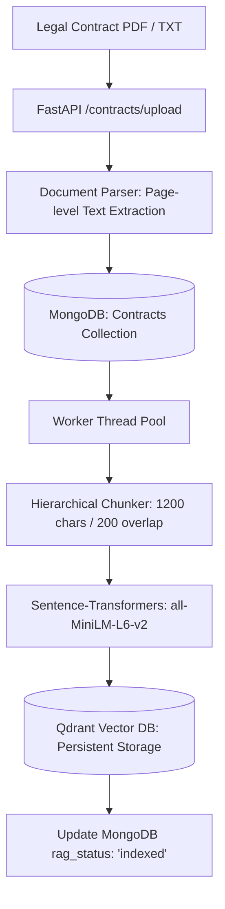
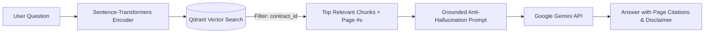

# Lexiscan — Automated Legal Contract Parsing & Intelligence Engine

[](https://fastapi.tiangolo.com)
[](https://www.python.org/)
[](https://ai.google.dev/)
[](https://qdrant.tech/)
[](https://huggingface.co/sentence-transformers/all-MiniLM-L6-v2)
[](https://www.mongodb.com/)
[](https://opensource.org/licenses/MIT)

**Lexiscan** is an enterprise-grade legal contract intelligence and Retrieval-Augmented Generation (RAG) API built with **FastAPI**, **Google Gemini**, **Qdrant**, **Sentence-Transformers**, and **MongoDB**.

It automates contract due diligence by extracting page-level text, segmenting legal clauses, classifying risks, and enabling attorneys and business teams to **chat directly with their uploaded contracts** using verified vector retrieval and page-cited answers.

---

## ⚡ Key Capabilities

- **Resilient Multi-Format Ingestion**: Validates, sanitizes, and extracts structured page-level text and metadata (page numbers, word counts) from PDF and TXT contracts.
- **Contract-Specific RAG Chat (`/ask`)**: Ask natural-language questions about any uploaded contract. Answers are strictly grounded in retrieved document passages with explicit page citations (e.g. `[Page 3]`).
- **Strict Vector Isolation**: Vector search is strictly filtered by `contract_id` at the Qdrant database engine level. Chunks from Contract A can never leak into Contract B queries.
- **Automated Background Indexing**: Asynchronous thread-pool embedding generation offloads CPU-intensive workloads so uploads remain fast and responsive.
- **Automated Clause Segmentation & Risk Analysis**: Identifies and isolates key clauses (Indemnity, Termination, Non-Compete, Confidentiality) and classifies risks into 4 severity tiers (`Low`, `Medium`, `High`, `Critical`) with targeted remediation advice.
- **Contract Re-Indexing (`/reindex`)**: Safe, idempotent re-indexing with deterministic vector IDs allows updating or recovering vector indexes without data loss.
- **Document & Audit Persistence**: Persists uploaded contracts, metadata, RAG status (`pending`, `indexed`, `failed`), and structured analysis reports in MongoDB.

---

## 🏗️ Architecture & Pipeline

### 1. Ingestion & RAG Indexing Pipeline



### 2. Contract-Specific Chat Pipeline (`/ask`)



---

## 🛠️ Tech Stack

| Layer | Technology | Purpose |
| :--- | :--- | :--- |
| **Backend Framework** | [FastAPI](https://fastapi.tiangolo.com/) | Asynchronous REST API routing, Pydantic validation, and OpenAPI documentation |
| **LLM & Reasoning** | [Google Gemini](https://ai.google.dev/) | Legal reasoning, structured clause analysis, and grounded question answering |
| **Embeddings** | [Sentence-Transformers](https://www.sbert.net/) | Dense 384-dimensional vector embeddings via `all-MiniLM-L6-v2` |
| **Vector Database** | [Qdrant](https://qdrant.tech/) | Persistent local vector storage and cosine similarity retrieval with metadata filtering |
| **Document Processing** | [PyPDF2](https://pypdf2.readthedocs.io/) | Stream parsing and page-preserving textual extraction from legal PDFs |
| **Primary Database** | [MongoDB](https://www.mongodb.com/) | Document store for contract text, page metadata, analysis audits, and RAG status |
| **Infrastructure** | [Docker Compose](https://docs.docker.com/compose/) | Containerized local MongoDB deployment |

---

## 🚀 Getting Started

### 1. Prerequisites
- **Python 3.10+** (tested up to 3.13)
- **Docker & Docker Compose** (for local MongoDB) or an active MongoDB Atlas instance
- **Google Gemini API Key** ([Get an API Key from Google AI Studio](https://aistudio.google.com/apikey))

### 2. Clone the Repository
```bash
git clone https://github.com/awasthypranshu/Lexiscan-Highlighting-automated-legal-parsing-and-intelligence..git
cd Lexiscan-Highlighting-automated-legal-parsing-and-intelligence.
```

### 3. Environment Setup
Create a virtual environment and install dependencies:

```powershell
# Windows (PowerShell):
python -m venv venv
.\venv\Scripts\Activate.ps1
pip install -r requirements.txt

# Linux / macOS:
python3 -m venv venv
source venv/bin/activate
pip install -r requirements.txt
```

### 4. Configure Environment Variables
Copy `.env.example` to `.env`:
```bash
cp .env.example .env
```

Update `.env` with your settings:
```env
# MongoDB Connection URI
MONGODB_URI=mongodb://localhost:27017

# Google Gemini API Key
GOOGLE_API_KEY=your_gemini_api_key_here

# Gemini Model Identifier
GEMINI_MODEL=gemini-4-argon

# Qdrant Vector Storage (Local embedded path)
QDRANT_PATH=./qdrant_data

# Sentence Transformers Embedding Model
EMBEDDING_MODEL=sentence-transformers/all-MiniLM-L6-v2
```

> [!NOTE]
> `QDRANT_PATH=./qdrant_data` runs Qdrant in embedded local mode without requiring a separate Docker container for development. For multi-worker production deployments, connect to a standalone Qdrant server or Qdrant Cloud.

### 5. Launch MongoDB
```bash
docker compose up -d
```

### 6. Run the Application
Start the FastAPI development server:
```bash
uvicorn app.main:app --reload --host 127.0.0.1 --port 8000
```
Interactive API documentation will be available at: **`http://127.0.0.1:8000/docs`**

---

## 📖 API Documentation & Endpoints

### 1. Upload Contract (with Automatic RAG Indexing)
```http
POST /contracts/upload
Content-Type: multipart/form-data
```
Uploads a `.pdf` or `.txt` contract file (max 10MB). Automatically parses text, preserves page breakdown, indexes vectors in Qdrant, and sets `rag_status="indexed"`.

**Sample Response (HTTP 200):**
```json
{
  "message": "Contract uploaded successfully",
  "contract_id": "67277be9404f7d90d6554072",
  "rag_status": "indexed",
  "chunks_indexed": 8,
  "contract": {
    "id": "67277be9404f7d90d6554072",
    "file_name": "0a28360c431f4f139c486e8400a9481b.pdf",
    "original_name": "Master_Services_Agreement_2026.pdf",
    "page_count": 4,
    "word_count": 1820,
    "status": "Uploaded",
    "rag_status": "indexed"
  }
}
```

---

### 2. Chat with Your Contract (RAG `/ask`)
```http
POST /contracts/{contract_id}/ask
Content-Type: application/json
```
Asks a question about a specific uploaded contract. Retrieves the most relevant passages from Qdrant and generates a grounded, cited answer using Google Gemini.

**Request Body:**
```json
{
  "question": "What is the termination notice period and under what conditions can either party terminate?"
}
```

**Sample Response (HTTP 200):**
```json
{
  "contract_id": "67277be9404f7d90d6554072",
  "question": "What is the termination notice period and under what conditions can either party terminate?",
  "answer": "Either party may terminate the Agreement for convenience by providing thirty (30) days' prior written notice to the other party. In addition, either party may terminate immediately for cause if a material breach remains uncured for fifteen (15) days following written notice. [Page 3]\n\n⚠️ This answer is for informational purposes only and is not a substitute for professional legal advice.",
  "sources": [
    {
      "page": 3,
      "text": "Section 11.2 Termination for Convenience. Either party may terminate this Agreement at any time without cause upon thirty (30) days prior written notice. Section 11.3 Termination for Cause. If either party commits a material breach...",
      "score": 0.8542
    },
    {
      "page": 1,
      "text": "1.4 'Notice Period' means the 30-day timeline defined under Section 11.",
      "score": 0.7120
    }
  ]
}
```

---

### 3. Re-Index Contract
```http
POST /contracts/{contract_id}/reindex
```
Re-reads the contract text from MongoDB and generates fresh embeddings in Qdrant. Uses deterministic UUIDs so re-indexing is completely idempotent.

**Sample Response (HTTP 200):**
```json
{
  "contract_id": "67277be9404f7d90d6554072",
  "message": "Re-indexing complete. 8 chunks indexed.",
  "chunks_indexed": 8,
  "rag_status": "indexed"
}
```

---

### 4. Comprehensive Clause & Risk Analysis
```http
GET /analysis/contract/{contract_id}
```
Performs deep legal reasoning on the contract using Gemini, categorizing clauses, assessing risks (`Low` to `Critical`), and persisting audit reports.

**Sample Response (HTTP 200):**
```json
{
  "message": "Analysis completed successfully",
  "id": "67265a393a4bc602b9f8d91b",
  "result": {
    "contract_id": "67277be9404f7d90d6554072",
    "contract_type": "Master Services Agreement (MSA)",
    "summary": "IT consulting and software delivery agreement with standard intellectual property assignment and quarterly renewal terms.",
    "overall_risk_level": "medium",
    "key_clauses": [
      {
        "clause_title": "Intellectual Property Ownership",
        "clause_text": "All Work Product created under this Agreement shall belong exclusively to Client upon receipt of full payment...",
        "explanation": "Client owns deliverables once fully paid for; vendor retains pre-existing tools.",
        "is_standard": true
      }
    ],
    "risk_flags": [
      {
        "risk_title": "Unilateral Fee Increases",
        "description": "Vendor may adjust hourly rates upon 15 days notice without cap.",
        "risk_level": "medium",
        "recommendation": "Tie rate increases to CPI index with an annual maximum of 5%.",
        "clause_reference": "Section 4.3"
      }
    ],
    "recommendations": [
      "Add a reciprocal confidentiality obligation.",
      "Require mutual written consent for rate adjustments."
    ]
  }
}
```

---

### 5. List All Contracts
```http
GET /contracts/
```
Returns all stored contracts with their metadata, word counts, and `rag_status`.

---

## 🧪 Testing

The repository includes a comprehensive test suite (50 automated tests) verifying text extraction, chunking, vector isolation, re-indexing, error handling, and endpoint validation:

```powershell
# Run the entire test suite
python -m pytest tests/ -v
```

```text
======================= 50 passed, 4 warnings in 13.54s =======================
```

All tests mock out external Gemini API calls and utilize an isolated temporary Qdrant directory, allowing full verification without consuming external API quota or needing a live database.

---

## 📂 Project Structure

```text
API Contract/
├── app/
│   ├── routes/
│   │   ├── __init__.py
│   │   ├── contracts.py         # Upload, list, and get contract routes (with background indexing)
│   │   ├── chat.py              # [NEW] Contract-specific RAG chat (/ask) & re-indexing (/reindex)
│   │   └── analysis.py          # Gemini legal analysis and audit routes
│   ├── services/
│   │   ├── __init__.py
│   │   ├── document_parser.py   # Page-aware PDF and TXT text extraction
│   │   ├── rag_service.py       # [NEW] Core RAG engine: chunking, embeddings, Qdrant & Gemini QA
│   │   ├── gemini_analyse.py    # Google GenAI contract analysis orchestration
│   │   └── prompt.py            # Legal prompt templates & JSON extraction schemas
│   ├── config.py                # App configuration (Qdrant, Gemini, MongoDB)
│   ├── database.py              # MongoDB connection & index initialization
│   ├── main.py                  # FastAPI application entrypoint & router registration
│   └── models.py                # Pydantic data schemas (Contract, AskResponse, AnalysisResult)
├── tests/                       # Automated test suite (50 unit & integration tests)
│   ├── test_document_parser.py  # Tests for page-level extraction
│   ├── test_rag_service.py      # Tests for chunking, vector isolation, and grounding
│   └── test_api_endpoints.py    # Integration tests for /upload, /ask, /reindex, and /analysis
├── uploads/                     # Local storage directory for uploaded documents
├── .env.example                 # Environment configuration template
├── .gitignore                   # Ignore rules (excludes .env, qdrant_data/, logs, venv/)
├── docker-compose.yml           # Containerized local MongoDB service
├── requirements.txt             # Production dependencies
└── README.md                    # Project documentation
```

---

## 🛡️ Security & Privacy

- **Strict Multi-Tenant Isolation**: RAG search applies mandatory metadata filters (`contract_id`) inside Qdrant — queries for Contract A will never return passages from Contract B.
- **Anti-Prompt-Injection Safeguards**: Contract text is treated as untrusted data within the LLM prompt, preventing contract content from overriding system instructions.
- **Grounded Anti-Hallucination**: The LLM is instructed to answer solely based on retrieved passages, cite exact page numbers, and disclaim answers as non-legal advice.
- **Zero API Key Leakage**: Sensitive credentials are read strictly from environment variables and omitted from error responses.
- **Safe File Storage**: Uploaded files receive cryptographically random UUID filenames to prevent collision and path traversal attacks.

---

## 📜 License
This project is licensed under the MIT License — see the [LICENSE](LICENSE) file for details.
